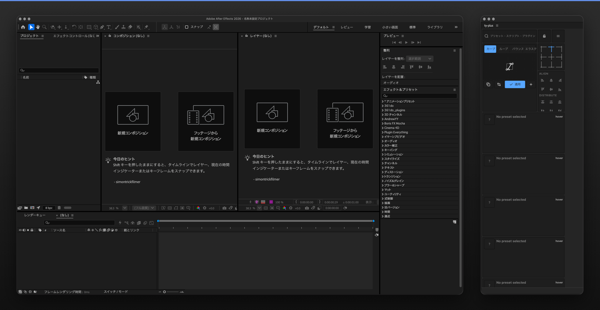

# ty-plus

**After Effectsのプリセットとツールを、一つのワークスペースに。**  
ty-plusは、Adobe After Effects向けの無料・オープンソースのCEP拡張機能です。再利用する操作を整理し、ワークスペースをカスタマイズできます。

**[最新の安定版をダウンロード](https://github.com/ido-bata/ty-plus/releases/latest)** · [インストールガイド](docs/user-guide/installation/index.md) · [不具合を報告](https://github.com/ido-bata/ty-plus/issues/new/choose)

**言語:** [English](README.md) · [日本語](README.ja.md) · [Deutsch](README.de.md) · [Français](README.fr.md) · [简体中文](README.zh.md) · [Español](README.es.md) · [한국어](README.ko.md) · [Português](README.pt.md) · [Italiano](README.it.md) · [Русский](README.ru.md)

## ty-plusでできること

プリセットやスクリプトをタイルで管理し、ウィジェットや複数のパネルを自分の作業に合わせて配置できます。設定やワークスペースの情報はローカルに保存されます。

- **プリセットとスクリプト：** よく使うAfter Effectsの操作を整理して呼び出す。
- **ワークスペース：** タイル、ウィジェット、パネル配置、外観をカスタマイズ。
- **ローカル優先：** 主要機能はオフラインで利用でき、ログインやサブスクリプションは不要。
- **更新チャンネル：** 設定 → 更新からStable / Beta / Insiderを選択。インストールは手動。

*公開済みの ty-plus v0.10.1（Stable）を Adobe After Effects 2026 上（macOS）で実際に起動した実画面です。*

## インストール

1. **[最新のStableリリース](https://github.com/ido-bata/ty-plus/releases/latest)**を開きます。
2. OSに合う `ty-plus-<tag>-windows.zxp` または `ty-plus-<tag>-macos.zxp` を取得します。
3. CEP対応のZXPインストーラで導入し、After Effectsを再起動します。
4. **ウィンドウ → エクステンション → ty-plus** から開きます。

各リリースには手動導入・検証用ZIPとプラットフォーム別manifestもあります。詳細と対処方法は[インストールガイド](docs/user-guide/installation/index.md)を参照してください。

## 対応環境と既知の制約

- **Windows x64 / macOS：** 公開済みv0.10.1のmacOS版は、After Effects 2026（26.5.3）で実機起動およびパネル表示を確認済みです。OS・After Effects バージョン全体でのE2Eカバレッジは未完了のままです。[検証Issue #10](https://github.com/ido-bata/ty-plus/issues/10)をご覧ください。
- **Windows：** ネイティブworkerはAuthenticode未署名です。Smart App Controlが有効な環境では起動がブロックされます。導入のためにOSの保護機能を無効化しないでください。
- **macOS：** v0.10.1のネイティブworkerはDeveloper IDで署名されていますが、**公証は未実施**です。隔離属性やOSのセキュリティポリシーによって起動が拒否される場合があります。
- **ZXP：** 継続利用する自己署名証明書で署名しています。ZXP署名とmacOS実行ファイルの公証は異なります。
- **更新：** GitHub Releasesの更新確認だけを行い、自動インストールはしません。

初回のStableは**更新チャンネル上の基準版**を意味します。すべてのOS・AE環境で検証済みという意味ではありません。

## 更新チャンネル

| チャンネル | 受信するリリース | タグ形式 |
| --- | --- | --- |
| Stable | Stableのみ | `vX.Y.Z` |
| Beta | StableとBeta | `vX.Y.Z-beta.N` |
| Insider | すべて | `vX.Y.Z-insider.N` |

[リリース一覧](https://github.com/ido-bata/ty-plus/releases) · [v0.10.1のリリースノート](https://github.com/ido-bata/ty-plus/releases/tag/v0.10.1)

## ドキュメント・参加方法

- [ユーザーガイド](docs/user-guide/index.md) (日本語) · [インストールガイド](docs/user-guide/installation/index.md) (日本語)
- [不具合報告・改善提案](https://github.com/ido-bata/ty-plus/issues/new/choose)
- [開発への参加](CONTRIBUTING.md) · [セキュリティ方針](SECURITY.md)
- [CIの実際の状態](https://github.com/ido-bata/ty-plus/actions/workflows/ci.yml). バッジはGitHub Actionsの実行結果をそのまま示すもので、テスト成功を保証する表示ではありません。請求設定によるジョブ開始前の失敗は[Issue #59](https://github.com/ido-bata/ty-plus/issues/61)で追跡しています。

開発環境は `mise install` と `bun install --frozen-lockfile --ignore-scripts` から準備できます。詳しくは[貢献ガイド](CONTRIBUTING.md)を参照してください。

## ライセンス

ty-plusは[MITライセンス](LICENSE)で公開しています。第三者の素材には別途の条件が適用されます：[THIRD-PARTY-NOTICES.md](THIRD-PARTY-NOTICES.md)。
