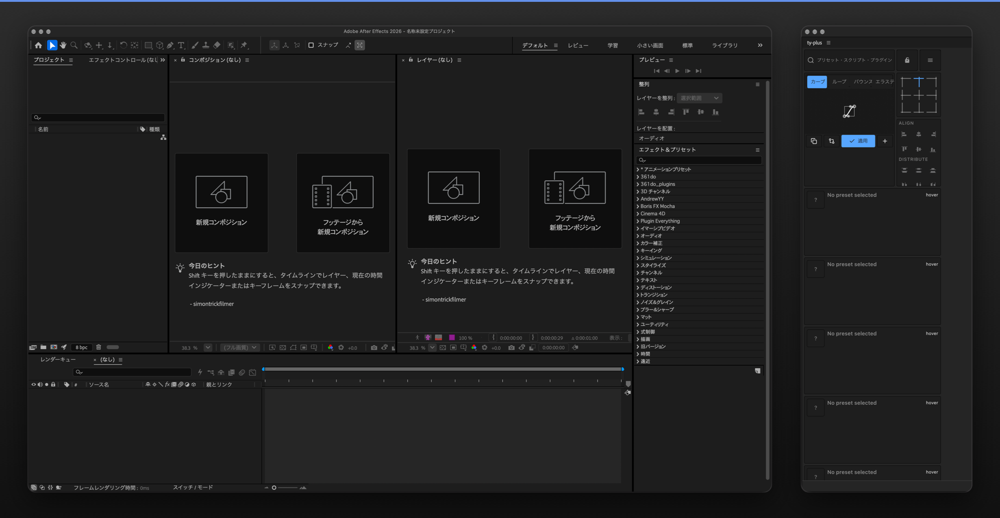

# ty-plus

**Пресеты и инструменты прямо в Adobe After Effects.**  
ty-plus — бесплатное CEP-расширение с открытым исходным кодом для организации повторяющихся действий и настройки рабочего пространства.

**[Скачать последнюю стабильную версию](https://github.com/ido-bata/ty-plus/releases/latest)** · [Инструкция по установке](docs/user-guide/installation/index.md) · [Сообщить об ошибке](https://github.com/ido-bata/ty-plus/issues/new/choose)

**Языки:** [English](README.md) · [日本語](README.ja.md) · [Deutsch](README.de.md) · [Français](README.fr.md) · [简体中文](README.zh.md) · [Español](README.es.md) · [한국어](README.ko.md) · [Português](README.pt.md) · [Italiano](README.it.md) · [Русский](README.ru.md)

## Возможности ty-plus

Размещайте пресеты и скрипты в виде плиток, добавляйте виджеты и настраивайте расположение панелей. Параметры и данные рабочего пространства хранятся локально.

- **Пресеты и скрипты:** организация и запуск часто используемых действий After Effects.
- **Настраиваемое рабочее пространство:** плитки, виджеты, панели и внешний вид.
- **Локальная работа:** основные функции доступны без интернета, регистрации и подписки.
- **Каналы обновлений:** Stable, Beta и Insider в «Настройки → Updates»; установка обновлений вручную.

*ty-plus v0.10.1 (Stable) в Adobe After Effects 2026 на macOS — реальная опубликованная версия.*

## Установка

1. Откройте **[последний Stable-релиз](https://github.com/ido-bata/ty-plus/releases/latest)**.
2. Скачайте `ty-plus-<tag>-windows.zxp` либо `ty-plus-<tag>-macos.zxp` для своей ОС.
3. Установите ZXP с помощью совместимого с CEP установщика и перезапустите After Effects.
4. Откройте **Window → Extensions → ty-plus**.

Каждый релиз также содержит ZIP-архивы и манифесты для ручной установки и проверки. Подробности см. в [инструкции по установке](docs/user-guide/installation/index.md) (на японском).

## Совместимость и известные ограничения

- **Windows x64 / macOS:** опубликованный ZXP v0.10.1 запускается на macOS (After Effects 2026, 26.5.3), панель открывается и отображается; полное E2E-покрытие по ОС и версиям After Effects ещё не завершено. См. [задачу #10](https://github.com/ido-bata/ty-plus/issues/10).
- **Windows:** нативный worker не подписан Authenticode; Smart App Control может заблокировать его. Не отключайте защиту ОС ради установки.
- **macOS:** нативный worker v0.10.1 подписан Developer ID, но **не прошёл нотариализацию**. Карантин и политика безопасности могут препятствовать запуску.
- **ZXP:** пакет подписан постоянным самоподписанным сертификатом. Подпись ZXP не заменяет нотариализацию macOS.
- **Обновления:** проверка GitHub Releases есть, но автоматической установки нет.

Первый Stable — **базовый релиз канала обновлений**, а не гарантия тестирования всех сочетаний ОС и версий After Effects.

## Каналы обновлений

| Канал | Получаемые версии | Формат тега |
| --- | --- | --- |
| Stable | Только Stable | `vX.Y.Z` |
| Beta | Stable и Beta | `vX.Y.Z-beta.N` |
| Insider | Все | `vX.Y.Z-insider.N` |

[Список релизов](https://github.com/ido-bata/ty-plus/releases) · [Примечания к v0.10.1](https://github.com/ido-bata/ty-plus/releases/tag/v0.10.1)

## Помощь и участие

- [Руководство пользователя](docs/user-guide/index.md) (на японском) · [Инструкция по установке](docs/user-guide/installation/index.md) (на японском)
- [Сообщить об ошибке или предложить улучшение](https://github.com/ido-bata/ty-plus/issues/new/choose)
- [Участие в разработке](CONTRIBUTING.md) · [Политика безопасности](SECURITY.md)
- [Реальный статус CI](https://github.com/ido-bata/ty-plus/actions/workflows/ci.yml). Значок показывает фактическое состояние GitHub Actions, но не гарантирует прохождение тестов. Сбои до запуска заданий из-за оплаты отмечены в [задаче #59](https://github.com/ido-bata/ty-plus/issues/61).

Для разработки выполните `mise install`, затем `bun install --frozen-lockfile --ignore-scripts`. Подробнее: [Contributing](CONTRIBUTING.md).

## Лицензия

ty-plus распространяется по [лицензии MIT](LICENSE). Для сторонних компонентов действуют отдельные условия: [THIRD-PARTY-NOTICES.md](THIRD-PARTY-NOTICES.md).
