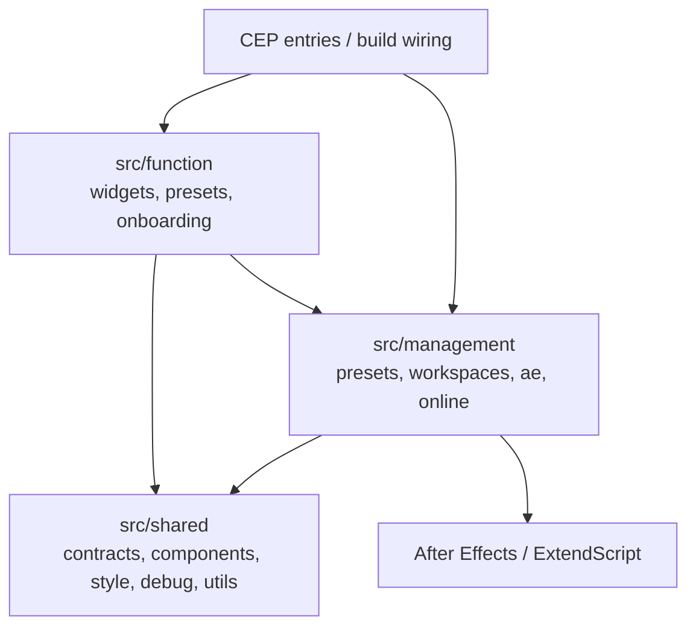

# 02 Target Architecture

## Status

This document defines the React/Tailwind reconstruction target after the source
ownership correction. It replaces the older package/surface-oriented target
shape. The source ownership authority is
[`../repository/source-ownership.md`](../repository/source-ownership.md).

## Architecture

React UI is not an ownership root. UI files are attached to the operation system
that owns the behavior.



The CEP entry files are thin bootstraps. They do not own product behavior.
Workspace panels, dialogs, widget bodies, and editors are UI endpoints under
their owning operation systems.

## Final Directory Ownership

Use this target shape. Keep every leaf directory at 8 files or fewer.

```text
src/
  shared/
    contracts/
    components/
      controls/
      fields/
      layout/
      icons/
      editors/
      shell/
      feedback/
    style/
    i18n/
    debug/
    utils/

  management/
    presets/
      records/
      indexing/
        list/
      authoring/
      assets/
      storage/
    workspaces/
      records/
      layout/
      runtime/
      panels/
      selection/
      persistence/
      messaging/
      appearance/
      settings/
    ae/
      cep/
        entry/
      commands/
      files/
      scripts/
    online/
      connectivity/
      account/
      licensing/
      catalog/
        list/
      notifications/
        list/

  function/
    widgets/
      system/
      search/
      menu/
      align/
      anchor/
      easing/
      text-style/
    presets/
      system/
      file/
      folder/
      code/
      footage/
      animation/
      layer-comp/
      import/
      easing/
      text-style/
    onboarding/
```

## Import Rules

- `src/shared/*` must not import from `src/management/*` or `src/function/*`.
- `src/management/*` may import from `src/shared/*`.
- `src/management/*` must not import concrete product behavior from
  `src/function/*`.
- `src/function/*` may import from `src/management/*` and `src/shared/*`.
- Widget registry contracts live in `src/function/widgets/system`.
- Workspace management may know widget ids, layout slots, registry contracts,
  and renderer contracts. It must not own concrete widget behavior.
- Preset management may own records, indexing, authoring base, assets, and
  storage. Preset type behavior belongs in `src/function/preset/*`.
- Online is `src/management/online`, not a generic `cloud` source root.
- CEP / evalScript / host command dispatch belongs in `src/management/ae`.
- UI files must live under the operation system that owns them.

## Forbidden Ownership Buckets

Do not introduce these as source ownership roots:

```text
features/
surfaces/
dialogs/
ui/
cloud/
legacy/
cep-shell/
```

These terms may appear in external artifact names or legacy current paths, but
they are not target ownership boundaries.

## Surface Boot Model

Each CEP entry follows the same lifecycle:

1. Resolve the CEP surface id or open parameters.
2. Create the required CEP transport.
3. Compose only the providers required by the owning operation systems.
4. Render a single React root.
5. Delegate behavior to management/function modules.
6. Dispose listeners on unmount or unload.

Do not make the entry file a feature owner. Do not group runtime code by panel,
dialog, or route.

## Build Contract

- `bun run build` must not require `src/js`.
- CEP artifact paths may remain `panel/index.html` and `dialog/index.html`.
- Source entrypoints may move under `src/management/ae/cep/entry`.
- Package workspaces may be removed as source ownership is flattened.
- Behavior, styling, data shapes, registry exposure, and host command payloads
  must remain unchanged during the ownership move.
