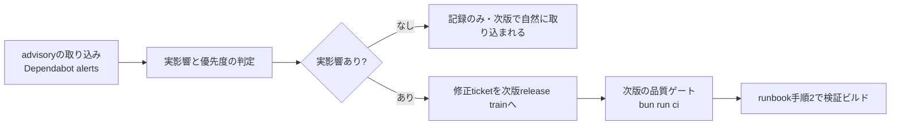

# 依存関係・脆弱性の継続メンテナンス運用（Issue #46）

- Status: Accepted
- Date: 2026-11-11
- 正本: 本doc。関連: #46 / #32（release-trustビルド）/ `docs/operations/release-runbook.md`（リリース手順）/ `docs/architecture/cost-gate.md`（secret排除）
- 受入条件: advisory取り込みから影響判定、次版への反映までの経路が文書化されていること。新しいセッションから同じ手順でメンテナンス作業を再現できること。

## 経路の概観

## 1. advisoryの取り込み

- 経路: GitHub **Dependabot alerts**（repository設定で有効化 — Settings → Code security → Dependabot alerts。personal repoでは既定で有効）。
- 収集の実施者: agentセッションの冒頭に `security-maintenance` Skillに従い、対象ecosystem（npm / cargo / Actions）のadvisoryを列挙する。
- 列挙したadvisoryは、次の3項目を判定材料として記録する。判断を飛ばさない:
  1. 影響するdependencyの実行path（コードから実際に到達するか）
  2. projectへの実影響の有無（offline core契約 `docs/architecture/offline-core.md` に抵触するか）
  3. 次版へ回すべきか、記録のみでよいか

## 2. 影響判定と優先度

- 実影響なし（未到達path・test専用・build専用）→ 本docの記録に残し、次版の更新で自然に解消されるかを確認する。緊急の修正は作らない。
- 実影響あり → 次版release trainへの修正ticket（1 Issue = 1 ticket branch = 1 PR、#46のdependencyラベル）として起票し、依存順にlandする。

## 3. 依存更新のゲート方針

- `bun.lock` / `Cargo.lock` の更新を含む変更は、品質ゲート **`bun run ci`**（`ci:static` + `ci:unit` + `ci:coverage`）を通す。ゲートを通らない更新はlandしない。
- version bumpだけの変更でも、ゲート通過は省略しない（#19の教訓: ゲートが静かに何もしないのが失敗モード）。
- GitHub ActionsのSHA pin更新手順: `.github/workflows/ci.yml` 冒頭コメントのとおり。pin対象のtag → SHA対応をrelease notesで確認してから更新する。

## 4. リリース後の不具合修正が次版へ反映される経路

- runbook（`docs/operations/release-runbook.md`）の手順1から新しいversionで実行し直す。hotfix専用経路は作らない（緊急patchもrelease PRを経由する）。
- 修正ticketは #46ラベルで起票し、次版のrelease trainに明示的にretargetする。

## 再現手順（新しいセッションから）

1. `security-maintenance` Skillを読む。
2. Dependabot alertsを列挙し、本docの手順2の判定材料で優先度を決める。
3. 実影響ありなら、1 Issue = 1 ticket branchで起票し、`bun run ci` を通す変更としてPR化する。
4. 実影響なしなら、本docに記録して次版での自然解消を確認する。
5. リリースはrunbookの手順に従う。メンテナンス作業単独では公開しない。

## 非目標

- Dependabot version PRの自動merge（品質ゲート通過後も、landingは通常のticket運用に従う）
- advisoryの自動優先度付け（判定は人とagentの協業で行う）
