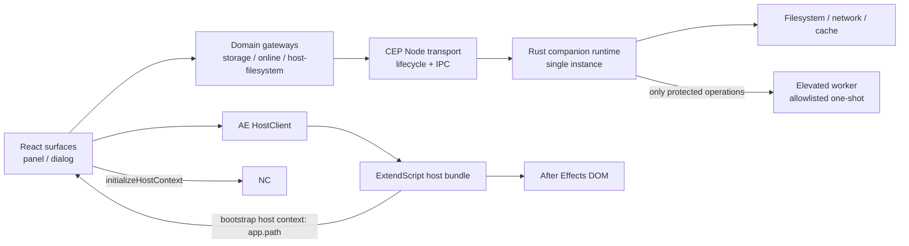

# Rust runtime 境界再設計プラン

> Status: architecture proposal / not canonical
>
> この文書は大幅設計変更の判断材料と実行順を固定する作業計画である。合意後に、確定した知識だけを `docs/architecture/` の各正規文書へ反映する。この文書自体を実装仕様の参照元にはしない。

実装時はこの文書から直接作業を選ばず、[`README.md`](README.md) と [`status.md`](status.md) を入口にして固定 ID の task を一つずつ実行する。

## 1. 結論

ty-plus の実行責務を、次の三つへ再編する。

| 実行領域 | 所有する責務 | 所有しない責務 |
| --- | --- | --- |
| React / TypeScript | UI、画面状態、ユースケース調停、入力検証、ドメインモデルとの変換、進捗表示 | OS ファイル API、直接 HTTP、シェル、UAC、AE DOM |
| After Effects ExtendScript | AE DOM、選択・プロジェクト・コンポジション操作、`app.path` 取得、AE undo group | 汎用ファイル保存、ネットワーク、パス探索、権限昇格、キャッシュ |
| Rust companion runtime | ファイル・ディレクトリ、パス正規化、永続化、インデックス、ハッシュ、アーカイブ、HTTP/TLS、ダウンロード、認証セッション、キャッシュ、限定的な権限昇格 | AE DOM、React UI、widget / preset type 固有の表示判断 |

Rust は「巨大な補助関数集」ではなく、OS とネットワークに対する唯一の実行 runtime とする。ただし TypeScript 側を実装方式だけでまとめず、storage、online、host filesystem という責務ごとの gateway を各 domain の近傍に置く。React と ExtendScript に同種の代替経路を残さない。

Rust 側は、現行 WIP の都度起動 CLI 方式から、複数 CEP surface が共有するオンデマンド起動・単一インスタンスの companion runtime 方式へ変更する。UI を持つ Tauri アプリは採用しない。製品 UI は引き続き AE 内の React surface が所有する。

## 2. この判断が必要な理由

現行実装では、同じ OS 操作が複数の経路へ分散している。

- ExtendScript の `File` / `Folder`
- CEP の `window.cep.fs`
- CEP Node の `fs` / `child_process`
- React runtime の `fetch`
- PowerShell / AppleScript による昇格処理
- ストレージごとの個別 read / write / fallback

調査時点で、ファイル操作に関係する TS / ExtendScript source は広範囲に存在し、権限処理は `src/management/storage/write/elevation-service.ts`、初期化は `src/management/setting/onboarding/initialization.ts`、AE 側ファイル処理は `src/management/storage/extendscript/` などへ分散している。ネットワークは主に `src/management/online/` にあるが、ダウンロード後の保存が再び ExtendScript / CEP 側へ戻るため、失敗境界と進捗境界が一致していない。

この状態では、次の問題が構造的に残る。

- パスの解釈と権限判定が実行経路ごとに異なる。
- 書き込み成功の定義が一貫せず、部分ファイルやサイレント失敗を扱いにくい。
- 大きなバイナリを JS / ExtendScript 境界で運ぶコストが高い。
- UAC 用の文字列組み立てがアプリケーション処理へ漏れる。
- 複数 panel / dialog が同じ保存先やキャッシュを競合更新できる。
- HTTP、認証、ダウンロード、ハッシュ検証、永続化が一つのトランザクションにならない。

## 3. 変更しない前提

- 対象ホストは After Effects のみ。
- `appRoot` の唯一の正は ExtendScript 側の `app.path` とする。
- `appRoot` をレジストリ、固定パス、環境変数、`/Applications` の探索から決定しない。
- AE の project / active item / selection に触れる処理は ExtendScript に残す。
- React UI は Tailwind utility で構成し、ネイティブ側に第二の UI を作らない。
- 現行の保存データ shape は、ネイティブ境界導入と同時には変更しない。定義元と使用元は `docs/architecture/data/` の導線に従う。
- `reference/`、`archive/`、`docs/no-use/`、既存の別 plan を現行要件の根拠にしない。

## 4. 変更が必要な現行前提

正規 source を TypeScript の `src/` 一つとみなす前提は、製品 runtime としての Rust 導入後には不十分になる。互換目的で Rust を `tools/` に置き続けず、合意後は次の二つを product source として明記する。top-level は言語境界として `rust/` とし、その内側は技術名ではなく責務で分ける。

```text
src/                      React / TypeScript / ExtendScript source
├─ function/
├─ management/
└─ shared/

rust/                     Rust product source
├─ Cargo.toml
├─ crates/
│  ├─ protocol/
│  ├─ storage/
│  ├─ online/
│  ├─ licensing/
│  └─ host-filesystem/
└─ apps/
   ├─ runtime/
   └─ elevated-worker/

scripts/                  build / dev / package utilities only
```

既存の `tools/ty-plus-cli/` は新しい source authority にしない。再利用可能な実装は内容を監査して `rust/` の該当責務へ移すが、現行 CLI の責務や配置を維持するための adapter は作らない。

## 5. 目標実行経路



重要なのは、Rust と ExtendScript を直結しないことである。React / TypeScript のユースケース層が責務別 gateway と HostClient を調停する。

- `HostClient`: AE に対する操作。
- storage gateway: 永続化、asset、index に対する操作。
- online gateway: HTTP、download、sync に対する操作。
- host-filesystem gateway: AE 関連 path、plugin、preset、script に対する OS 操作。

共通 IPC は operation API を所有せず、framing、接続、lifecycle、handshake だけを扱う。TypeScript の配置は次を基本形とし、実装方式名だけの横断 bucket は作らない。

```text
src/management/
├─ ipc/                         transport / lifecycle / generated wire contract
├─ storage/runtime-gateway.ts  storage operation adapter
├─ online/runtime-gateway.ts   online operation adapter
└─ ae/files/runtime-gateway.ts host-filesystem operation adapter
```

例えば preset 適用は、Rust から AE を操作するのではなく、次の順になる。

1. React のユースケースが Rust にローカル asset の準備を依頼する。
2. Rust が取得、検証、atomic write を完了し、正規化済みの参照を返す。
3. React がその参照を ExtendScript へ渡す。
4. ExtendScript が AE undo group 内で適用する。

これにより、OS I/O の再試行と AE DOM 操作の再試行を別々に扱える。

## 6. appRoot と host context

起動時に ExtendScript は、最小の host context を返す。

- `appRoot`: `app.path` から取得した値
- `supportRoot`: その AE application instance が既定で使用する support root
- AE version（診断表示にのみ使用し、分岐条件にはしない）
- locale
- host identifier
- 必要なら process / session を識別する値

TypeScript はこの値を検証し、Rust runtime の `initializeHostContext` へ渡す。Rust はそこから preset / script / plugin の候補パスを組み立てられるが、`appRoot` 自体を発見・補正・置換しない。

現行 WIP にある `app-root` subcommand、`AE_INSTALL_PATH`、Windows registry、macOS `/Applications` 探索は、この固定前提と衝突するため廃止対象とする。開発時の override が必要なら、AE 内で取得した値とは別の明示的な test fixture とし、製品 runtime へ入れない。

処理や保存形式を AE version に依存させない。複数 version の同時起動を許可し、Rust runtime は `appRoot` や `supportRoot` を process-global な一値として保持しない。接続 session ごとの immutable host context とし、各 request は session ID に関連付ける。

managed root は、ユーザーが明示的に共有先を指定しない限り、その session の `supportRoot` を source とする。したがって複数 AE application は既定ではそれぞれの support root を使う。明示設定で同じ managed root を指定した場合だけ共有し、共有時の同時書き込みは一つの Rust runtime が直列化する。

## 7. Rust companion runtime の形

### 7.1 ライフサイクル

- CEP Node transport が初回要求時に runtime を起動する。
- OS user 単位で単一インスタンスとする。
- 二重起動は OS lock と IPC endpoint の双方で防ぐ。
- panel、modeless dialog、複数 workspace surface は同じ runtime に接続する。
- 接続がなく、処理中 task もない状態が一定時間続いたら終了する。
- OS login 時の常駐、自動起動、tray UI は導入しない。
- crash 後の再起動は transport が一度だけ行う。非 idempotent request を暗黙再送しない。

### 7.2 IPC

推奨 transport は local HTTP / WebSocket ではなく、ユーザー境界を持つ OS local IPC とする。

- Windows: named pipe
- macOS: user-only application control folder 内の Unix domain socket
- framing: length-prefixed JSON、または同等に境界が明確な framed JSON
- request / response / event の三種を同一 connection 上で扱う
- 大きなバイナリは JSON に載せず、Rust が直接 file / stream を処理する

TCP port を採用しない理由は、port 競合、firewall、origin、他プロセスからの到達性、認証処理を不要に増やすためである。stdio だけの child process も、複数 CEP surface 間で共有しにくいため最終形にはしない。

runtime の lock、socket、discovery metadata を OS temp へ置かない。installer と extension が同じ規則で解決できる、ユーザーから確認可能な user-level application control folder に集約する。この folder は AE version や個別 managed root から独立し、複数 AE application が同じ runtime を発見するためだけに使う。保持物を protocol version、process identity、endpoint、lock に限定し、reset 対象と配置を storage map に明記する。

### 7.3 handshake

接続直後に最低限次を交換する。

- protocol major / minor
- extension build version
- runtime build version
- client instance ID
- capability set
- session nonce
- host context 登録状態

major 不一致は fail closed とする。minor 差は capability negotiation で扱う。実行ファイルがない、署名が不正、protocol が合わない場合に ExtendScript / CEP fs へ自動 fallback しない。ユーザーへ修復可能なエラーを提示する。

### 7.4 platform 実装の配置

Windows と macOS で処理が分岐する operation は、同じ変更で両方を実装する。片方の fallback や未実装を release branch に残さない。platform 差分は該当 domain の直下で隣接させ、離れた共通 bucket へ集約しない。

```text
rust/crates/host-filesystem/src/install/
├─ mod.rs
├─ windows.rs
├─ macos.rs
├─ windows_test.rs
└─ macos_test.rs
```

原則は `mod.rs` に共通 contract と分岐だけを置き、`windows.rs` と `macos.rs` に同じ operation の実装を並べることとする。platform 固有処理を追加する pull request は、両 platform の実装、test、error mapping、package 反映を一つの完了条件とする。

## 8. protocol 設計

wire contract は domain model のコピーではない。既存 data shape を無条件に IPC へ露出せず、ユースケースに必要な request / result だけを定義する。

各 request は次のメタ情報を持つ。

- request ID
- method
- protocol version
- client / host session ID
- deadline
- cancellation 可否
- idempotency key（書き込み系の必要箇所）

各 result は次を持つ。

- request ID
- success / failure
- machine-readable error code
- retryable flag
- user-safe detail
- diagnostics correlation ID
- payload または warning

長時間処理は progress event を返し、cancel request を受け付ける。progress には byte 数だけでなく、`discovering`、`downloading`、`verifying`、`committing` のような安定した stage を使う。

エラー code は OS 文言をそのまま UI contract にしない。少なくとも次の分類を持つ。

- invalid request / incompatible protocol
- host context missing / stale
- not found / already exists
- permission denied / elevation declined
- path outside allowed scope
- network unavailable / timeout / remote rejected
- integrity mismatch
- storage corrupt / migration required
- busy / conflict / cancelled
- internal error

wire schema の正は `rust/crates/protocol/` に置く。Rust の serialize 型から machine-readable schema と TypeScript 型を生成し、生成物を `src/management/ipc/generated/` に配置する。既存ドメイン型との対応は責務別 gateway の handwritten mapper で明示し、生成 DTO を UI component へ直接流さない。

generator の具体選定は最初の spike で固定する。生成結果の差分、round-trip fixture、unknown field、optional field、整数範囲を CI で検証できることを採用条件とする。

## 9. Rust runtime が所有する API の粒度

`readFile(path)` や `fetch(url)` のような無制限 primitive を UI へ公開しない。内部では primitive を使っても、IPC は製品の operation と capability に閉じる。

初期 API 群の候補は次の通り。

### Host / diagnostics

- runtime health / version / capabilities
- host context registration
- writable-path preflight
- support bundle 作成（secret redaction 済み）

### Workspace / local storage

- managed root の初期化
- workspace snapshot の read / commit
- catalog / records の read / commit
- settings / preference の read / commit
- asset import / export / archive
- index build / refresh / query
- directory selection結果の検証

### AE related filesystem

- ExtendScript から渡された `appRoot` を基にした path resolution
- plugin / effect scan
- preset / script install preflight
- install / uninstall / verify

### Online

- connectivity status
- authentication session / refresh
- catalog query
- signed download URL の取得
- asset download、hash 検証、atomic commit
- notification / license query
- sync queue

React は URL、header、token、保存先をばらばらに組み立てない。例えば online preset download は一つの Rust operation とし、ネットワーク取得から保存・整合性検証までを Rust 側の task とする。

## 10. ファイル・ストレージ設計

### 10.1 保存場所の原則

永続するものはユーザーが確認・reset・version 移行できる application folder に集約する。OS や library の暗黙 cache directory、隠れた補助 directory、独自 temp root へ分散させない。

- workspace、settings、records、index、操作履歴、download 済み asset は各 session の managed root 配下へ置く。
- 検索 cache は永続データとして managed root 配下へ置き、ユーザーが明示削除するまで保持する。
- 操作履歴の保持上限は設定で変更でき、件数による最大値を必ず設ける。
- reset は managed root の manifest を基に対象を列挙でき、別場所の残骸探索を必要としない。
- version 移行は managed root 内の format version と migration record から追跡する。
- 本当に破棄可能で、消失しても product state や再現性に影響しない一時 cache だけ、OS 標準 temp directory を使用できる。
- OS temp に置いた内容は process 間の正や永続 cache として参照しない。

managed root 外へ置けるものは、installer が管理する実行 binary、OS credential store 内の secret、前節の application control folder、OS temp の破棄可能 cache に限定する。この例外一覧を増やす場合は storage architecture の変更として扱う。

atomic commit の transaction file は cache ではない。destination と同じ volume で atomic replace するため、対象 file と同じ directory に一時的な transaction 名で作成し、commit または失敗処理で直ちに除去する。常設の `temp/` directory は作らない。起動時には残存 transaction file を検出し、commit 済みデータを優先して安全に回収する。

### 10.2 path policy

- Rust 内部では platform path を文字列連結しない。
- IPC 入力の path は lexical normalization だけで信用せず、操作直前に root scope を検証する。
- symlink / junction / reparse point による root escape を防ぐ。
- managed root、AE app root、ユーザーが明示選択した import / export root を capability として区別する。
- OS path と表示用 path を混同しない。
- case sensitivity、UNC、長い Windows path、Unicode normalization を test matrix に含める。

### 10.3 write policy

- destination と同一 directory の transaction file へ書く。
- 内容を flush し、必要な永続性レベルで同期する。
- format / checksum を検証する。
- rename / replace で commit する。
- 複数ファイル更新は manifest または journal で commit point を持つ。
- 既存ファイル変更時は recovery 可能な backup policy をデータ種別ごとに決める。
- Rust runtime 内で path / workspace 単位の lock を持つ。

React に fire-and-forget persistence を残さない。UI は Rust result を受けてから保存済み state へ遷移する。高頻度 UI state は debounce してよいが、最後の commit と失敗は観測可能にする。

同じ managed root に対する同期 conflict は後書き優先とする。local の複数 AE session は一つの runtime が受理した commit 順を正とし、client の wall clock を比較に使わない。将来の remote sync は server が受理した revision 順を正とする。後書きで失われた revision は、設定された操作履歴上限の範囲で recovery 可能にする。

### 10.4 data migration

最初の切替では保存 shape を維持し、writer だけを Rust へ変更する。shape 変更が必要な場合は別 migration として実施する。

- format version を読み取る。
- migration 前 backup を作る。
- temp output を完全検証する。
- atomic replace する。
- migration result と correlation ID を記録する。
- 新 version を旧 writer で再度書かないよう、機能切替と旧 writer 削除を同じ変更に含める。

## 11. ネットワーク・認証設計

すべての製品 HTTP/TLS は Rust が所有する。React の online module は gateway port を呼ぶユースケースと表示へ縮退する。

- API base、media origin、timeout、retry policy は Rust runtime config に集約する。
- retry は idempotent operation のみに適用し、指数 backoff と jitter を使う。
- download は stream で temp file へ書き、content length と hash を検証してから commit する。
- online に依存しない機能は offline でもすべて利用可能にする。
- 検索 cache は stale 扱いで自動削除せず、ユーザーが消すまで永続利用できる。
- online 専用 operation だけが接続失敗を返し、local storage や AE operation 全体を停止させない。
- arbitrary URL proxy を提供しない。
- signed URL は HTTPS、期限、許可 origin、redirect 先を検証する。
- log に token、署名付き query、個人情報を出さない。

現行製品には online 認証方式がないが、aescripts での公開に必要な license 認証を Rust の `licensing` domain として追加する。認証 token を React の localStorage や平文 JSON に保持しない。refresh credential は OS credential store に置き、React へは session status、期限、ユーザー表示情報だけを返す。

一度有効化された環境では offline 利用を許可するが、aescripts license だけは定期的な online 再検証を必須とする。再検証間隔、grace period、端末変更、時刻改ざん、aescripts API 障害時の規則は integration 調査後に固定する。認証サーバーが不調でも、既に保持する local data を破壊・初期化しない。

## 12. UAC / 管理者権限

Rust runtime 本体は常に通常ユーザー権限で動かす。runtime 全体を昇格させない。

保護 path への操作だけ、別 binary の `elevated-worker` を一回限り起動する。

- method は install / replace / remove などの allowlist に限定する。
- generic shell、任意 command、任意 script を受け付けない。
- request は nonce、期限、期待 binary hash、source / destination scope、期待 content hash を持つ。
- worker は request を再検証し、対象外 path なら拒否する。
- UI で実行内容を説明してから OS consent を要求する。
- consent 拒否は通常の取消エラーとして扱う。
- 終了後に postcondition を通常権限 runtime が再検証する。

最初に「本当に保護 path へ書く必要がある operation」を列挙する。ユーザー領域で達成できる操作に UAC を使わない。macOS の認可方式、署名・notarization との関係は独立 spike にする。

## 13. セキュリティ境界

Rust runtime は CEP から到達できる強い権限面になるため、次を必須とする。

- IPC endpoint は同一 OS user だけが接続可能。
- install ごとの secret または起動時 nonce を handshake に使用する。
- 実行ファイルの署名と bundle version を transport が検証する。
- operation と path root を capability で制限する。
- arbitrary filesystem、arbitrary URL、arbitrary process execution API を作らない。
- request size、queue length、同時 task 数へ上限を設ける。
- parser failure と unknown method は fail closed。
- runtime log は structured、size-rotated、redacted とする。
- support bundle は明示操作でのみ生成し、path / token を除去する。

Rust を採用しただけでは安全にならない。入力 scope、権限、protocol、配布物の検証が境界の本体である。

## 14. 障害モデル

| 障害 | 期待する挙動 |
| --- | --- |
| Rust binary 不在 | 修復導線を表示。旧 JS 経路へ fallback しない |
| protocol major 不一致 | 操作を拒否し、extension / runtime version を表示 |
| runtime crash | 接続を失敗にし、一度だけ再起動。書き込み request は自動再送しない |
| panel close | cancelable task を cancel。commit 中の task は runtime が整合性を完了して記録 |
| network offline | cache policy に従う。書き込み sync は queue または明示失敗 |
| UAC 拒否 | 取消として返し、通常 runtime を昇格しない |
| disk full | temp を破棄し、既存 committed file を保持 |
| corrupt JSON | 自動上書きせず、backup / recovery choice を返す |
| 同時更新 | 同じ root は runtime が直列化し、後書きを採用する |
| AE 再起動 / version 切替 | host session を無効化し、ExtendScript から再登録 |

## 15. 移行原則

長期の二重実装や互換 layer は作らない。安全確認のための shadow read は期間と削除条件を決め、製品結果の fallback には使わない。

一つの vertical slice は、次を同じ変更単位で完了する。

1. Rust operation と contract を追加する。
2. Rust unit / integration test を追加する。
3. TypeScript port と contract test を追加する。
4. 対象ユースケースを Rust operation へ切り替える。
5. 対応する CEP fs / Node fs / ExtendScript / fetch 経路を削除する。
6. 直接利用を再導入できない architecture check を追加する。
7. 正規 architecture docs を更新する。

## 16. 実行フェーズ

### Phase 0: 判断固定と WIP 整理

- 本 plan の残る設計値を決定する。
- ADR 相当の決定を正規 architecture docs へ配置する。
- 現行 `tools/ty-plus-cli/` WIP を監査し、再利用 / 廃棄を file 単位で決める。
- `app-root` discovery を進めない。
- product source root に `rust/` を加える repository 規則を確定する。

Gate: 責務表、process model、IPC、appRoot、elevation、network ownership に未決がない。

### Phase 1: protocol と runtime skeleton

- Cargo workspace を `rust/` に作る。
- protocol / storage / online / licensing / host-filesystem と runtime app の責務境界を作る。空の総合 `core` crate は作らない。
- OS single-instance、IPC、handshake、health、version、shutdown を実装する。
- `src/management/ipc/` に transport / lifecycle を置き、operation adapter は各 domain の近傍に置く。
- 生成 contract と cross-language fixture test を作る。
- dev mode を含め、実 Rust binary を必ず起動する。UI 開発時も旧 JS 実装や mock process へ置換しない。
- package に Windows / macOS の binary を必須で含める。片方の欠落時は build / package を失敗させる。

Gate: 複数 panel / dialog から一つの runtime へ接続でき、互換性不一致と crash を再現できる。Windows / macOS の両方で通過する。

### Phase 2: read-only filesystem

- host context 登録を実装する。
- `app.path` 由来の appRoot だけを受け入れる。
- path resolution、directory scan、exists / metadata、plugin / preset scan を移す。
- read path の結果を現行実装と fixture / shadow test で比較する。
- 対象 ExtendScript / CEP read path を削除する。

Gate: Windows / macOS、複数 AE version、Unicode、長い path、権限不足で同じ contract を満たす。

### Phase 3: managed storage writer

- JSON / text / binary の atomic commit 基盤を実装する。
- workspace、layout、widget、settings、catalog の順に writer を切り替える。
- revision conflict、backup、recovery、disk full test を追加する。
- fire-and-forget persistence を解消する。
- `window.cep.fs`、CEP Node fs、ExtendScript writer を slice ごとに削除する。

Gate: crash injection 後も committed data が壊れず、旧 writer が production path に残っていない。

### Phase 4: online / download / auth

- connectivity、HTTP client、catalog gateway を Rust へ移す。
- download + hash + atomic commit を一つの Rust task にする。
- 永続検索 cache と offline policy を managed root に実装する。
- aescripts integration、credential store、定期 online 再検証を実装する。
- React runtime の製品 `fetch` を削除する。

Gate: token redaction、offline、timeout、cancel、redirect、integrity mismatch、partial download を検証する。

### Phase 5: protected install と elevation

- 保護 path を必要とする operation を確定する。
- platform ごとの preflight を実装する。
- allowlisted elevated-worker を実装する。
- Windows と macOS の両実装を同じ phase で完成させる。
- binary signing / notarization / package verification を release gate に入れる。
- PowerShell / AppleScript 組み立てを TypeScript から削除する。

Gate: 通常操作は UAC を出さず、拒否・改ざん・scope escape・partial install が安全に失敗する。

### Phase 6: 旧境界の完全削除

- `tools/ty-plus-cli/` の旧構造を削除する。
- 汎用 ExtendScript File / Folder operation を削除する。
- UI / use-case から `fs`、`child_process`、`fetch`、shell 呼び出しを削除する。
- 不要になった CEP Node option / polyfill / type を整理する。
- docs、build、installer、release gate を最終構造へ更新する。
- Rust runtime は extension と同じ version で installer に同梱し、独立 updater は作らない。

Gate: architecture check と repository search が禁止経路 0 件を示す。

## 17. 最初の vertical slice

最初から認証や UAC を選ばず、`plugin / effect scan` を推奨する。

理由:

- read-only でデータ破壊リスクが低い。
- appRoot の正しい受け渡しを検証できる。
- 大量ディレクトリ走査という Rust の効果が見えやすい。
- progress、cancel、複数 surface、path normalization を一通り試せる。
- 現行 WIP に stub があるが、その設計を温存せず新 protocol で作り直せる。

次点は managed root の単一 JSON read / atomic write とする。online / UAC は process と contract が安定してから着手する。

## 18. 品質ゲート

### Rust

- format / lint / unit test
- protocol serialization fixture
- filesystem property / adversarial path test
- crash injection と atomicity test
- platform integration test
- dependency / license / vulnerability check
- release binary size と startup / idle resource budget

### TypeScript / ExtendScript

- generated contract が clean であること
- domain gateway mapper test
- protocol 単体 test では in-process fake を使えるが、dev mode と E2E は実 Rust runtime を使う
- 実 runtime を使う integration test
- ExtendScript host bundle test
- `app.path` authority test

### Architecture checks

- `src/function/` から IPC transport 実装を直接 import しない。
- `src/` の許可場所以外で Node `fs` / `child_process` を使わない。
- 製品 TS source に直接 `fetch` / XHR / WebSocket がない。
- ExtendScript に汎用 `File` / `Folder` read-write を追加しない。
- Rust protocol から AE DOM concept を import しない。
- package に Windows / macOS の runtime が揃わなくても成功する経路を許さない。
- official docs が旧経路を authority として参照していない。

### Release

- Windows signed binary
- macOS signed + notarized binary
- installer / extension / 内包 Rust binary の version 一致
- clean machine install
- upgrade / downgrade / corrupt install recovery
- Windows / macOS × 対応 AE version matrix

## 19. 観測性

ログは React、ExtendScript、Rust で別形式にせず、correlation ID で追跡できるようにする。

- React が use-case correlation ID を発行する。
- HostClient / domain gateway request に同じ ID を付ける。
- Rust は request ID、operation、stage、duration、result code を記録する。
- ExtendScript は command、duration、result code を返す。
- path は root alias + relative path へ redaction する。
- token、signed URL、file contents は記録しない。

ユーザー向け error と diagnostic detail を分離し、UI に OS 内部文言や secret を直接表示しない。

## 20. 採用しない案

### 都度起動 CLI を最終形にする

単純な read-only command には向くが、複数 surface、connection reuse、download progress、cancel、共有 lock、cache、auth session、sync queue には不向き。初期 bootstrap 用に残すのではなく companion runtime に統合する。

### localhost HTTP / WebSocket server

CEP から扱いやすい一方、port、firewall、origin、他 process 接続、認証、discovery を余分に抱える。OS local IPC を優先する。

### Tauri へ React UI も移す

AE 内 panel / dialog との二重 UI になり、今回の責務整理を超える。Rust application は UI を持たない companion runtime とする。

### Rust から ExtendScript を起動する

AE session / selection / undo の所有者が曖昧になる。AE 操作は TypeScript が HostClient 経由で調停する。

### runtime 全体を管理者起動する

ネットワーク、cache、parse を含む巨大な攻撃面が昇格する。限定 worker のみを一時昇格する。

### 旧経路への自動 fallback

障害を隠し、二つの実装を恒久保守することになる。binary / protocol 不整合は修復可能な明示エラーとする。

## 21. 確定した product decision

今回の設計判断として、次を確定する。

1. Windows と macOS は常に両方を実装する。platform 固有実装は同じ domain の近傍に並べ、片方だけの fallback や先送りを認めない。
2. 製品処理と保存形式を AE version に依存させない。複数 version の同時起動を許可する。
3. managed root を明示共有しない限り、各 AE application session が返す support root を source とする。
4. 現行 online 認証は存在しない。aescripts 公開に必要な license 認証を新設し、定期 online 再検証を行う。
5. online に依存しない全機能は offline で利用可能にする。
6. 検索 cache は managed root に永続化し、ユーザーが明示削除するまで保持する。
7. 操作履歴等の保持上限は設定可能にし、件数による hard maximum を設ける。
8. Rust runtime は extension と同時に installer が更新し、独立 updater を持たない。
9. 同期 conflict は後書き優先とする。local は runtime の commit 受理順、remote は server revision 順を正とする。
10. dev mode でも実 Rust binary を使用する。旧 JS 実装や mock process を interactive runtime の代替にしない。
11. 永続データと永続 cache は可視な application folder に集約する。OS temp は消失可能な一時 cache だけに許可する。

## 22. 実装前に値を固定する項目

以下は境界の再判断ではなく、実装に必要な具体値として固定する。

1. aescripts の正式な認証連携方式、再検証間隔、offline grace period、端末移行、時刻改ざん時の扱い。
2. UAC が必要な operation と destination root の完全な allowlist。
3. 操作履歴の既定件数、ユーザー設定可能範囲、hard maximum。
4. runtime の idle timeout、log rotation、diagnostic retention の上限。
5. managed root を明示共有する設定 UI、reset、共有解除時のデータ移動規則。

## 23. 合意後に更新する正規文書

確定後、少なくとも次を cohesive な単位で更新する。

- `docs/architecture/project.md`: 三実行領域と固定スコープ
- `docs/architecture/repository/index.md`: `rust/` を product source に追加
- `docs/architecture/repository/source-ownership.md`: TS / Rust ownership
- `docs/architecture/runtime/host-boundary.md`: HostClient / domain gateways / companion runtime / appRoot
- `docs/architecture/runtime/entrypoints.md`: Rust runtime lifecycle と package entrypoint
- `docs/architecture/storage/`: Rust writer と path / migration authority
- `docs/architecture/cloud/`: Rust network / auth / cache authority
- `docs/architecture/data/`: protocol 型の定義元と使用元への導線
- `docs/architecture/quality/`: cross-language / signing / architecture gates
- 必要な `docs/user-guide/`: install、修復、権限要求、offline 表示

正規文書へこの plan への参照は追加しない。確定した内容をそれぞれの目的別文書へ移す。

## 24. 実装開始条件

次が満たされるまでは、大規模な Rust 実装を追加しない。

- 第22節の具体値が決定済み。
- 現行 WIP を基に進める部分と廃棄する部分が明示済み。
- `appRoot` discovery 廃止が合意済み。
- IPC threat model と elevation operation allowlist がレビュー済み。
- 最初の vertical slice と測定値が決定済み。
- official docs の更新先と commit 分割が決定済み。

測定する初期値は、plugin scan の所要時間、runtime cold start、IPC round-trip、idle memory、package size、同時 surface 数、cancel latency とする。Rust 化の成否はコード量ではなく、旧 OS / network 経路の削除、失敗の一貫性、権限面の縮小、測定値で判断する。
