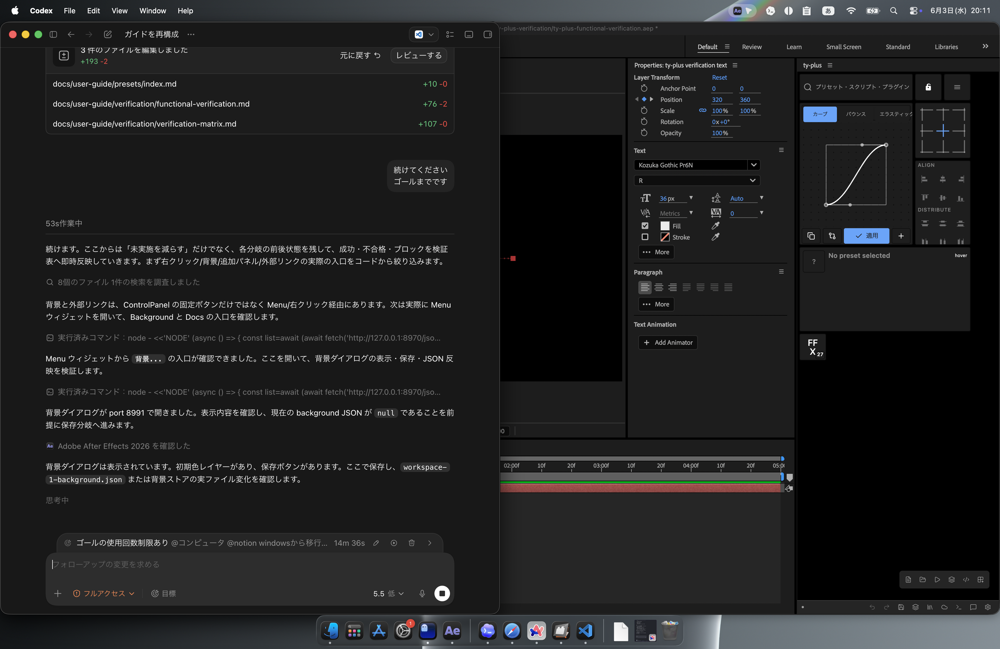
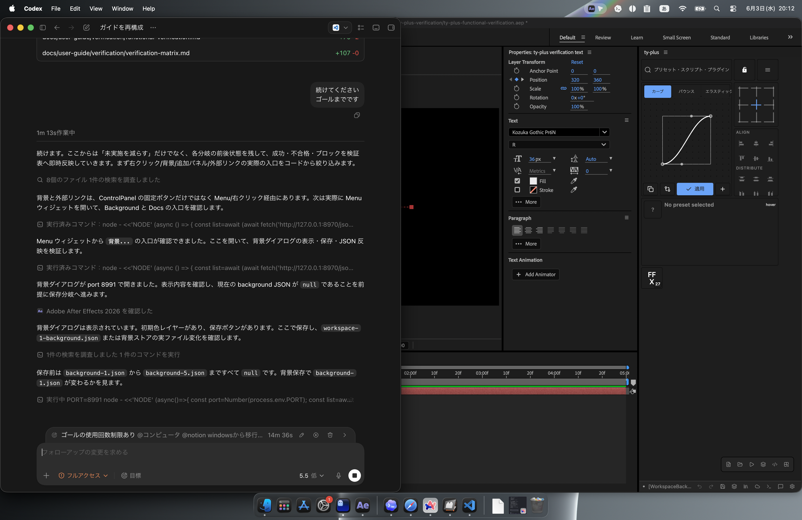

# 外観カスタマイズ

## 背景を変更する

背景設定パネルから、ワークスペースの背景を変更します。単色、パターン、画像を用途に合わせて選びます。

検証では Menu ウィジェットの `背景...` から `背景レイヤー - パネル 1` を開き、初期の単色レイヤー `#1e1e1e` を保存できました。保存後は `workspaces/background/background-1.json` に反映されます。

## パターンを使う

ドット、グリッド、ラインなどのパターンは、プリセットやウィジェットの位置を把握しやすくするために使います。

## 画像を使う

案件ごとに背景画像を変えると、作業用ワークスペースを見分けやすくなります。文字やボタンが読みづらくならない画像を選びます。

## スクリーンショット

外観カスタマイズの画像は、この章の `screenshots/` に保存します。
