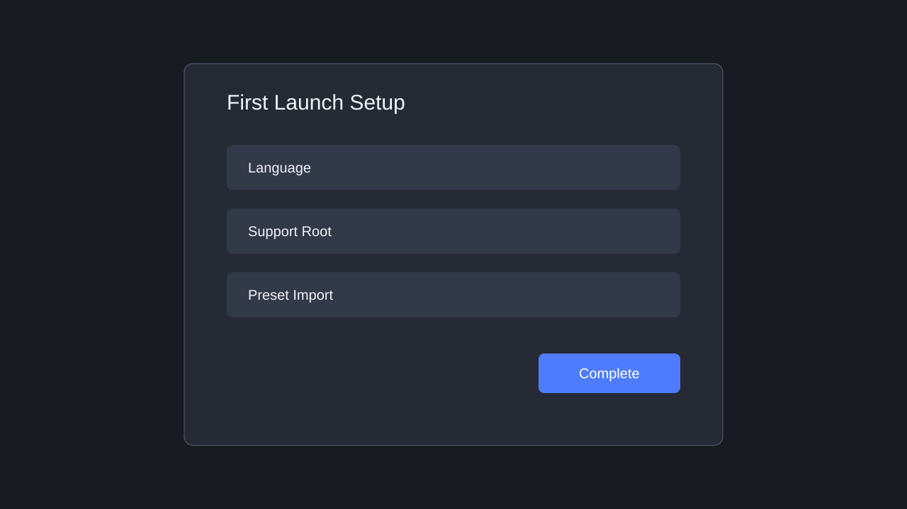

# はじめに

## 前提

- After Effects がインストールされていること。
- ty-plus の CEP 拡張がビルド済み、または配布パッケージとしてインストール済みであること。
- 初回起動時に、ty-plus が設定やプリセットを保存するサポートルートを指定できること。

開発版を使う場合は、リポジトリ直下で `bun run host` を実行すると、ビルド、インストール、After Effects 起動まで行います。配布版を使う場合は、配布手順に従って ZXP または展開済み CEP 拡張をインストールします。

## 起動する

1. After Effects を起動します。
2. `Window > Extensions` から ty-plus を開きます。
3. ty-plus パネルが表示されることを確認します。
4. 初回設定が表示された場合は、言語とサポートルートを選択します。必要に応じてヘッダーのトグルボタンでオンボーディングパネルを全画面に切り替えられます。
5. プリセットの取り込みが必要な場合は、プリセットフォルダを指定します。
6. 完了画面まで進み、ワークスペースが表示されることを確認します。

## 初回設定で決めること

| 項目 | 推奨 | 確認内容 |
| --- | --- | --- |
| 言語 | 普段使う UI 言語 | 保存後、再読み込みで反映される |
| サポートルート | ユーザーが書き込み可能な固定フォルダ | 設定、レイアウト、プリセットカタログが保存される |
| プリセットルート | `.ffx` やスクリプトを置くフォルダ | ディレクトリブラウザとプリセット作成で使われる |
| スクリプトルート | `.jsx` / `.jsxbin` を置くフォルダ | コードプリセットやクイックアクションで使われる |
| プラグインルート | プラグインや補助ファイルのフォルダ | 検索、参照、分類で使われる |

## 最初に確認する操作

1. ワークスペースでメニューウィジェットを開きます。
2. ウィジェット追加から任意のウィジェットを追加します。
3. プリセットを 1 件追加します。
4. 追加したプリセットをクリックして実行します。
5. 設定を開き、言語、パス、テーマの表示を確認します。
6. After Effects を再起動し、レイアウトと設定が復元されることを確認します。

## 正常に使える状態

- パネルが空白ではない。
- 初回設定が完了後に繰り返し表示されない。
- サポートルート配下に設定ファイルが作られる。
- プリセットまたはウィジェットを追加しても、After Effects の操作が固まらない。
- 再起動後にワークスペースの配置が復元される。
