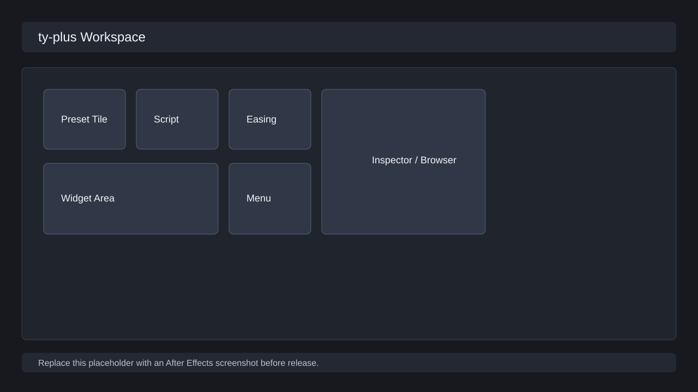

# ty-plus ユーザーガイド

<<<<<<< Updated upstream
対応: After Effects 2024 以降 / Windows・macOS

ty-plus は、After Effects の作業画面にプリセットとウィジェットを配置して、よく使う操作をすぐ実行できるようにする拡張機能です。

## 読む順番

1. [インストールと初期設定](installation/index.md)
2. [メイン画面の見方](main-screen/index.md)
3. [プリセット管理](presets/index.md)
4. [ウィジェット](widgets/index.md)
5. [オンラインプリセット](online-presets/index.md)
6. [メッセージ](messages/index.md)
7. [外観カスタマイズ](appearance/index.md)
8. [設定](settings/index.md)
9. [困ったとき](troubleshooting/index.md)
10. [機能検証](verification/functional-verification.md)
11. [スクリーンショット管理](screenshot-plan/index.md)

## 検証メモ

2026-06-03 に macOS / After Effects 2026 / ZXP Installer 1.8.801 で導入検証を行いました。ZXP の作成、署名、インストール、After Effects の Window > Extensions への表示まで確認済みです。

スクリーンショットは、それを使う章の直下にある `screenshots/` に保存します。例えば設定画面なら `docs/user-guide/settings/screenshots/feedback-01.png` のように配置します。
=======
ty-plus は After Effects 用の CEP 拡張です。ワークスペース上にプリセット、ウィジェット、設定パネル、補助ダイアログを配置し、よく使う AE 操作を短い導線で実行します。

## 読む順番

| ページ | 内容 |
| --- | --- |
| [はじめに](getting-started/index.md) | インストール、起動、初回設定、初回確認 |
| [ワークスペース](workspace/index.md) | タイル、ウィジェット、レイアウト、背景、複数パネル |
| [プリセット](presets/index.md) | プリセットの作成、編集、実行、分類、外部 JSX 連携 |
| [トラブルシューティング](troubleshooting/index.md) | 起動、権限、パス、表示、ホスト実行の復旧 |
| [販売品質検証チェックリスト](verification-checklist.md) | AE 上で全機能を検証するための機能別チェックリスト |

## 基本用語

| 用語 | 意味 |
| --- | --- |
| ワークスペース | プリセットタイルとウィジェットを配置するメイン画面 |
| プリセット | `.ffx`、スクリプト、フッテージ、コード、イージングなど、再利用する実行単位 |
| ウィジェット | 検索、メニュー、整列、イージング、フォント表示などの小さなツール |
| サポートルート | ty-plus が設定、プリセットカタログ、ワークスペース情報を保存するフォルダ |
| プライマリパネル | 通常操作の中心になる ty-plus パネル |
| セカンダリパネル | 補助表示や別ワークスペースとして使う追加パネル |

## 画像について

このガイドの画像は `docs/user-guide/assets/screenshots/` に置きます。現在の SVG は、実機検証時に撮影するスクリーンショットの差し替え位置を示す図版です。販売用に仕上げるときは、After Effects 上で同じ構図を撮影して同名ファイルへ差し替えます。
>>>>>>> Stashed changes
