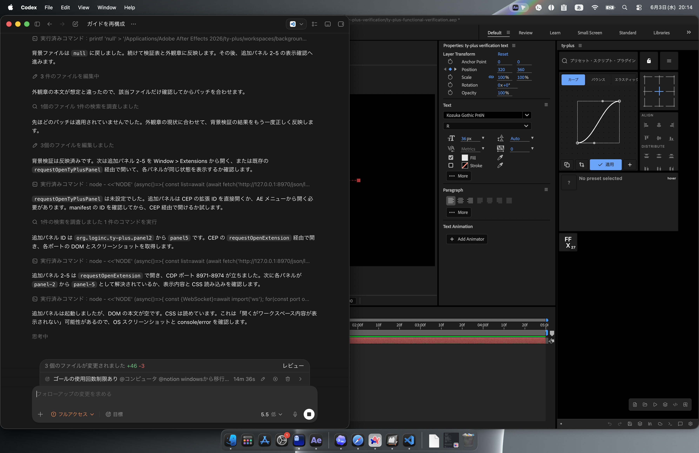
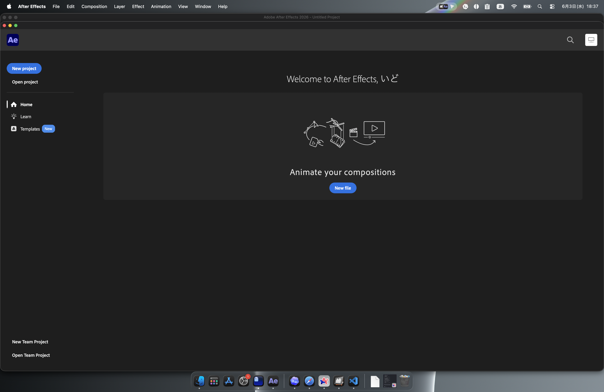
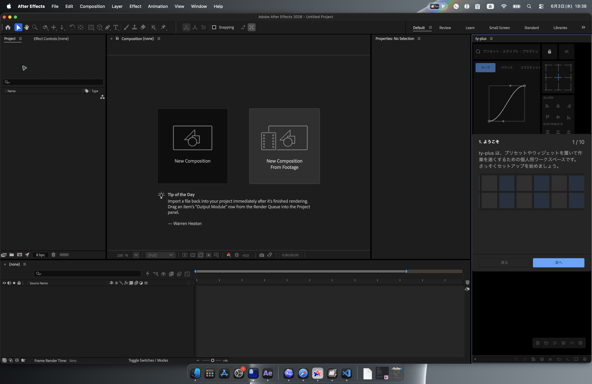
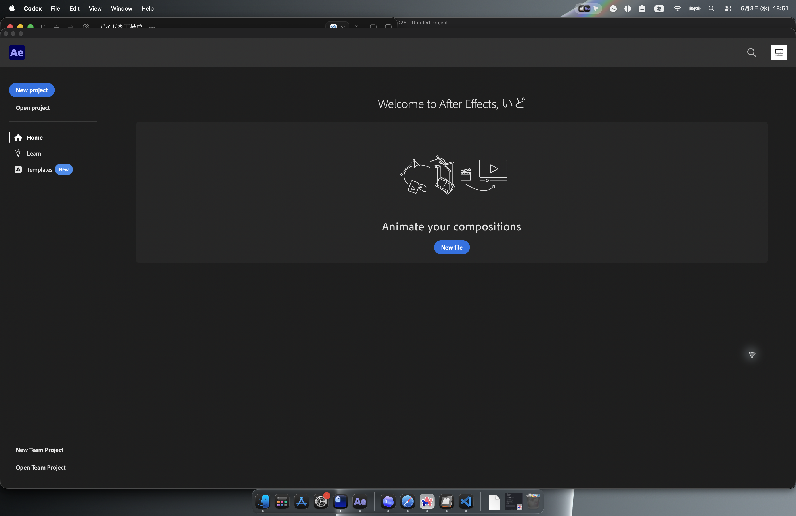

# メイン画面の見方

## ControlPanel

ControlPanel はワークスペース操作の入口です。プリセット追加、オンラインプリセット、設定、背景、メッセージ、その他の操作を開きます。

## 追加パネル

After Effects の `Window > Extensions` には `ty-plus panel 2` から `ty-plus panel 5` も表示されます。検証では各パネルを開くことはできましたが、主パネルと同じワークスペース内容は表示されず、空のグリッドと最小化された ControlPanel だけが表示されました。

よく使う流れは、ControlPanel からプリセット追加ダイアログを開き、作成したプリセットをワークスペースへ配置する流れです。

## 右クリックメニュー

ワークスペース上の右クリックでは、対象によってメニュー内容が変わります。検証では、workspace 空白、プリセットタイル、通常 widget、Easing widget、Align widget、Anchor widget、Info widget、Menu button のメニュー生成を確認しました。

詳細なメニューIDとラベルは `screenshots/main-13-context-menu-summary.json` に保存しています。削除系や Reset Workspace など破壊的な操作は実行していません。

基準 ZXP では、主パネルを開くと初回オンボーディングの DOM は存在するものの、パネルが黒く見えて操作内容を視認できませんでした。原因はシェル CSS の読み込み経路不足でした。

修正 ZXP を ZXP Installer で入れ直したあと、オンボーディングは After Effects 上でも視認できるようになりました。

## グリッド

ty-plus の作業領域はグリッドです。プリセットやウィジェットを配置し、必要に応じて移動、リサイズ、削除します。

レイアウトを固定したいときは Layout Lock を使います。固定中は誤ってウィジェットを動かしにくくなります。

オンボーディング完了後は、Easing、Align、Info、Layout Lock、Menu などの初期ウィジェットが配置されたワークスペースに戻ります。今回の検証では Adobe Express プリセットフォルダを選択したため、下部に `FFX 27` のグループタイルも追加されました。

## ステータスバー

ステータスバーには現在のパネル状態や操作対象が表示されます。複数パネルを開いている場合は、どの ty-plus パネルで操作しているかを確認します。

## 基本操作

1. `Window > Extensions > ty-plus` でパネルを開きます。
2. ControlPanel からウィジェットまたはプリセットを追加します。
3. グリッド上で配置を調整します。
4. レイアウトが決まったら Layout Lock を有効にします。

## スクリーンショット

メイン画面の画像は、この章の `screenshots/` に保存します。
