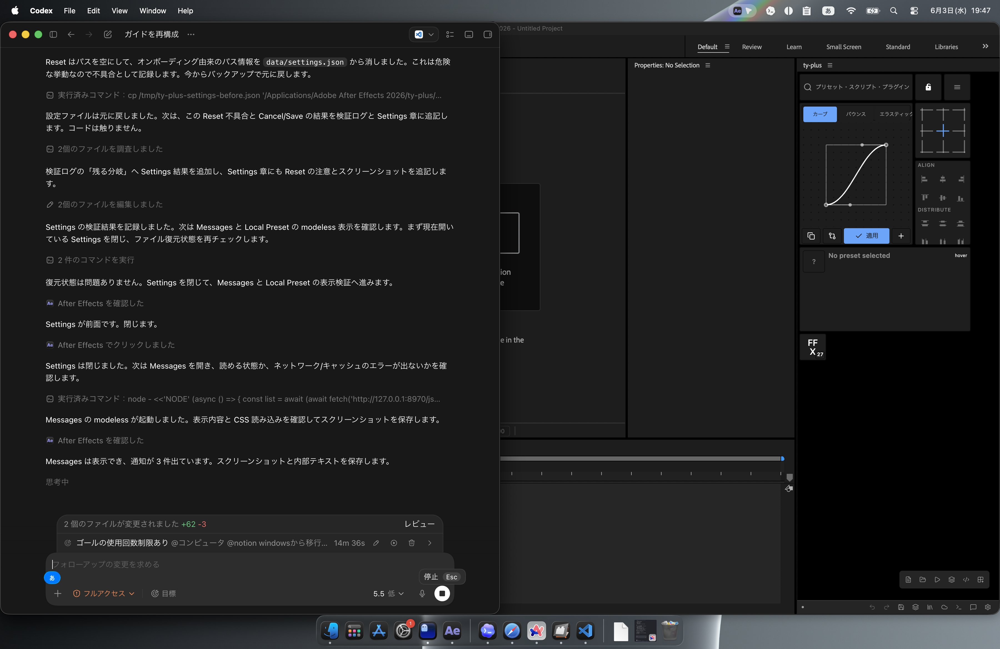

# メッセージ

Messages は、ty-plus からのお知らせや案内を確認する画面です。ControlPanel の Messages から modeless ウィンドウとして開きます。

検証では、フィードバック依頼とデモメッセージが一覧表示されました。

## 確認した表示

| 項目 | 結果 |
| --- | --- |
| 表示形式 | modeless ウィンドウ |
| 読み込み状態 | `cep-shell.bundle.css` を読み込み、黒画面にならず表示された |
| 表示件数 | 3 件 |
| 表示内容 | タイトル、本文、日時 |

## スクリーンショット

メッセージ画面の画像は、この章の `screenshots/` に保存します。
