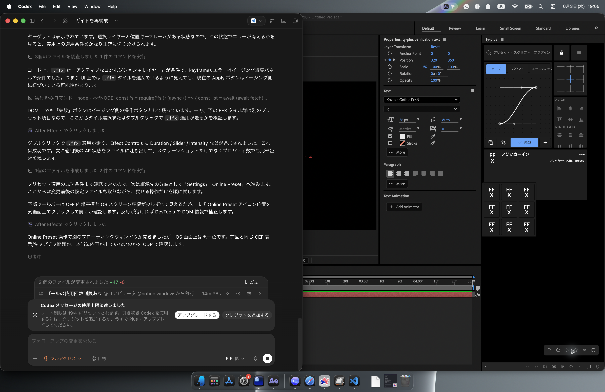
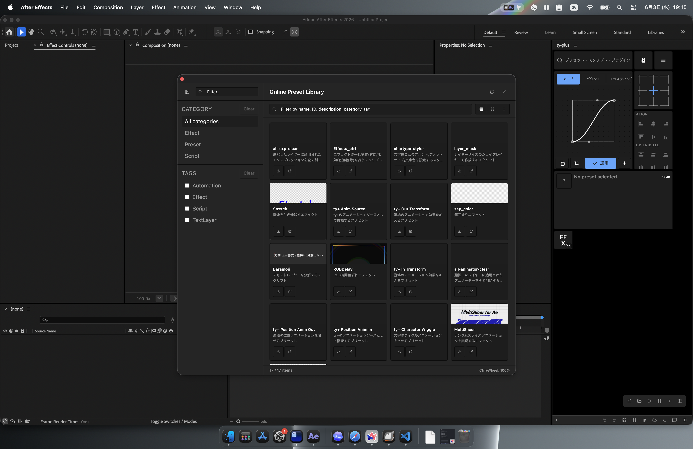
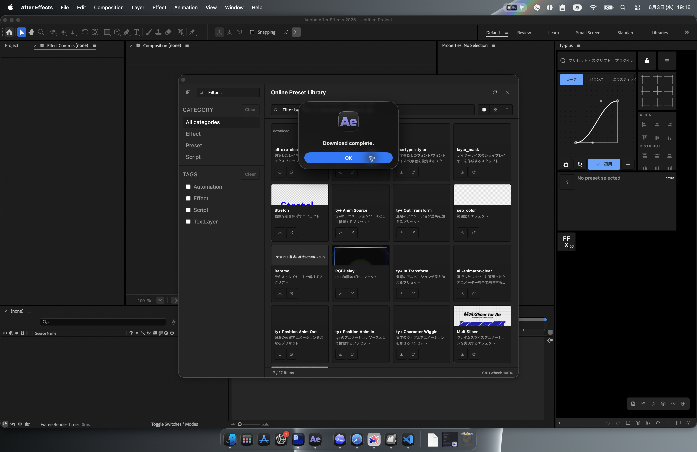

# オンラインプリセット

## ライブラリを開く

ControlPanel または Menu ウィジェットから Preset Library を開きます。

検証では修正 ZXP 適用前に modeless ウィンドウが黒く表示されました。`/Users/samuido/Desktop/ty-plus-modeless-fixed.zxp` を ZXP Installer で入れ直した後は、Online Preset Library が表示されました。

## 検索する

検索欄にキーワードを入力します。用途、カテゴリ、名前で探します。

## 表示を切り替える

ギャラリー表示、カード表示、リスト表示を切り替えて、探しやすい表示を選びます。

## ダウンロードして登録する

1. 使いたいプリセットを選びます。
2. Download を押します。
3. ローカルプリセットとして登録されたことを確認します。
4. ワークスペースへ配置して実行します。

現時点の検証では、`Download complete.` が表示されても実ファイルが保存されない不具合を確認しています。`presets.json` への登録だけが増えるため、修正されるまではオンラインプリセットのダウンロード結果を必ずファイル実体まで確認してください。

## スクリーンショット

オンラインプリセットの画像は、この章の `screenshots/` に保存します。
