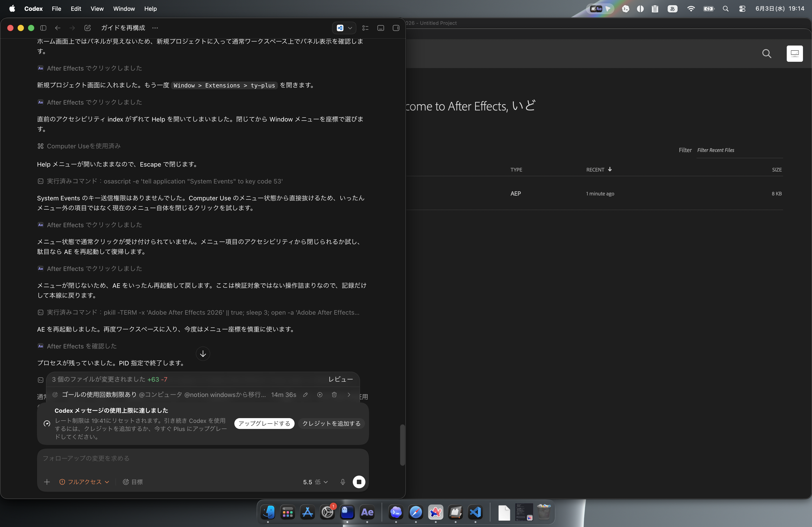
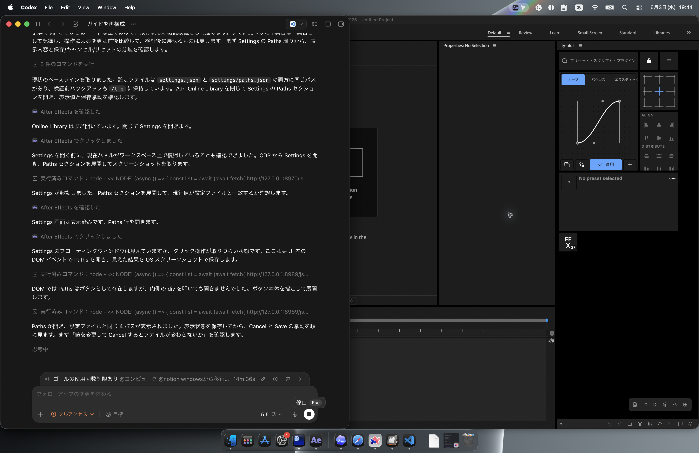
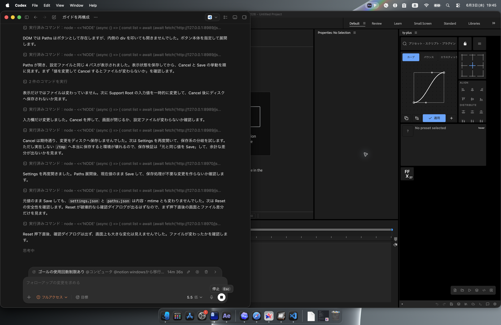

# 設定

Settings は ControlPanel の Settings から開きます。検証では modeless 修正 ZXP 適用後、黒窓ではなく設定画面が表示されることを確認しました。

## 言語

Language から UI 言語を切り替えます。Windows から移行した場合も、After Effects 側の言語とは別に ty-plus の表示言語を確認してください。

## 外観

テーマカラー、透明度、表示密度などを調整します。

## ホストパス

After Effects の Presets、Scripts、Plug-ins などのパスを確認します。Windows から macOS に移行した場合は、以前の `C:\...` パスをそのまま使わず、macOS 上の実在フォルダを選び直します。

検証では Paths セクションに次の 4 項目が表示されました。

- Support Root
- Preset Root
- Script Root
- Plugin Root

Cancel は未保存の入力変更を破棄し、設定ファイルを変更しませんでした。同じ値のまま Save した場合も、設定ファイルは変更されませんでした。

Reset は注意が必要です。検証では確認ダイアログなしで `data/settings.json` が変更され、`core.paths` の各値が空になりました。`settings/paths.json` は残るものの、設定が分断されます。Reset を押す前に、現在のパスを控えておくか、復元できる状態にしてください。

## ネットワーク

オンラインプリセットやクラウド連携を使う場合、ネットワーク設定を確認します。プロキシや社内ネットワークを使う場合は、接続できないことがあります。

## スクリーンショット

設定の画像は、この章の `screenshots/` に保存します。
