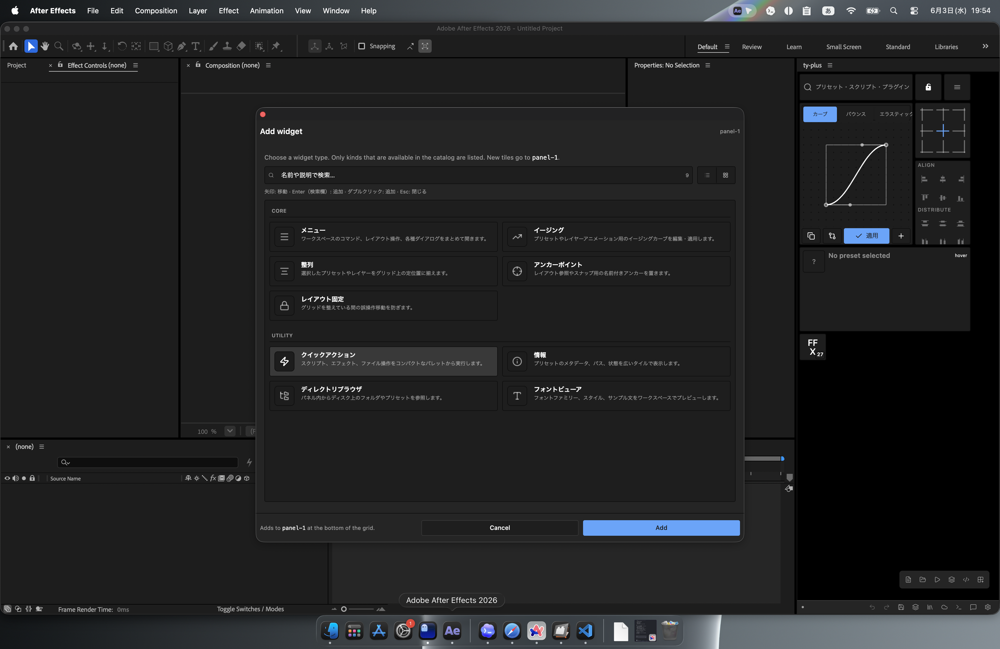
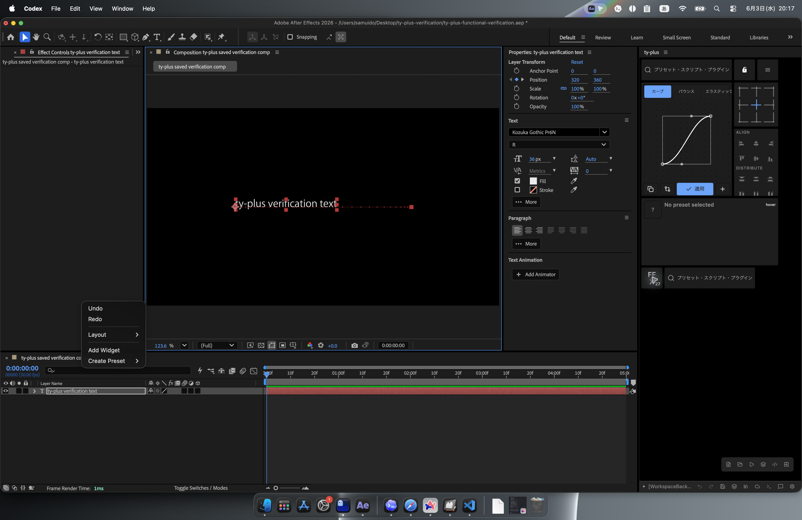
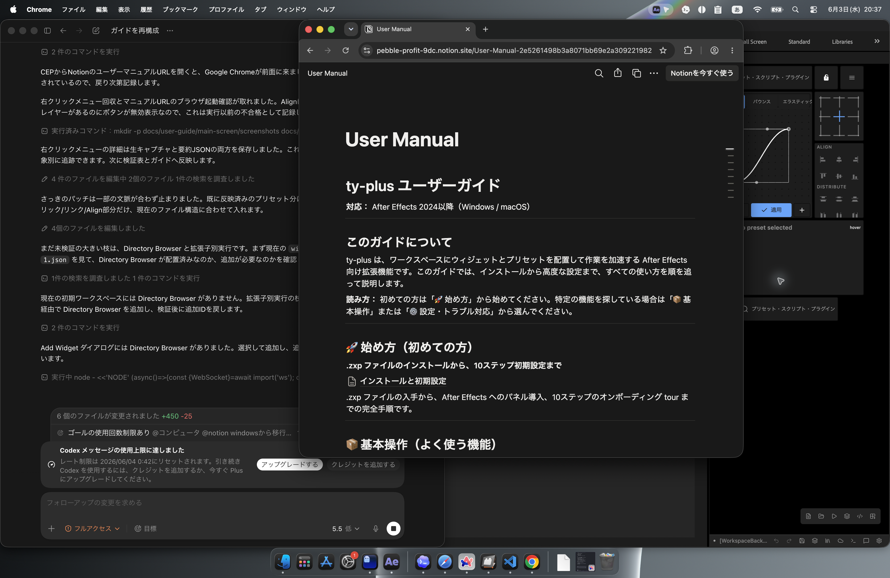
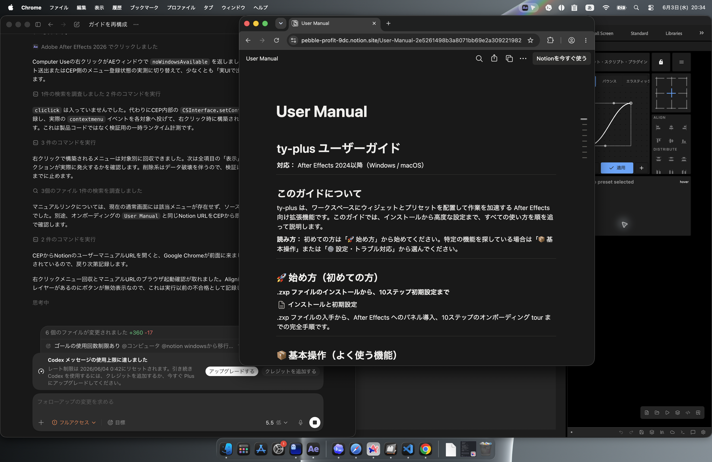

# ウィジェット

## Menu

Menu は、プリセット作成、プリセット検索、オンラインライブラリ、設定、レイアウト保存、再読み込みなどを開くメニューです。

## Easing

Easing はキーフレームの速度カーブを編集し、選択中のレイヤーへ適用するウィジェットです。カーブを作ってから、対象レイヤーを選択して適用します。

## Align

Align は選択中のレイヤーを整列・分布するウィジェットです。左右中央、上下中央、端揃え、間隔調整などを行います。

## Anchor Point

Anchor Point はアンカーポイントを 3x3 の位置へ移動します。中央、四隅、上下左右中央を選んで適用します。

## Layout Lock

Layout Lock はワークスペース配置のロックを切り替えます。配置調整が終わったら有効にして、誤操作を防ぎます。

## Info

Info は現在のコンポジション情報を表示します。サイズ、ピクセル縦横比、背景色、フレームレート、尺、レイヤー数、選択レイヤー数などを確認できます。

## Quick Actions

Quick Actions は頻繁に使う操作をまとめて実行するためのウィジェットです。日常作業で繰り返す操作を置く場所として使います。

## Directory Browser

Directory Browser はローカルフォルダを参照し、ファイルや素材を探すためのウィジェットです。オンボーディングで設定したルートフォルダを基準に使います。

## Font Viewer

Font Viewer はフォントの検索と確認に使います。テキスト作業時に候補を探し、必要なフォントを選びます。

## ウィジェットを追加する

ControlPanel の Add Widget から、ワークスペースへ追加するウィジェットを選びます。検証では `panel-1` に追加するカタログとして、Core と Utility の 9 種が表示されました。

`Add` を押すと `widgets.json` とワークスペースが変わる操作になります。表示確認だけを行う場合は `Cancel` で閉じます。検証では `Cancel` 後、`widgets.json`、`presets.json`、`groups.json`、`workspace-1.json` は変更されませんでした。

実追加の検証では、初期選択状態の `クイックアクション` を追加し、`widgets.json` と `workspace-1.json` の両方に同じ ID が追加されることを確認しました。

Directory Browser を追加しようとした検証では、一覧上の `ディレクトリブラウザ` をクリックしてから `Add` しても、実際には初期選択の `quick-actions` が追加されました。Directory Browser を使う検証は、この入口で止まっています。

## Align Widget の注意

保存済み AEP と選択レイヤーがある状態でも、検証時点では Align / Distribute の実行ボタンが無効表示でした。右クリックメニュー上には Align / Distribute / Spacing / Time の項目が出ますが、通常操作では実レイヤーへ適用できませんでした。

## スクリーンショット

ウィジェットの画像は、この章の `screenshots/` に保存します。
