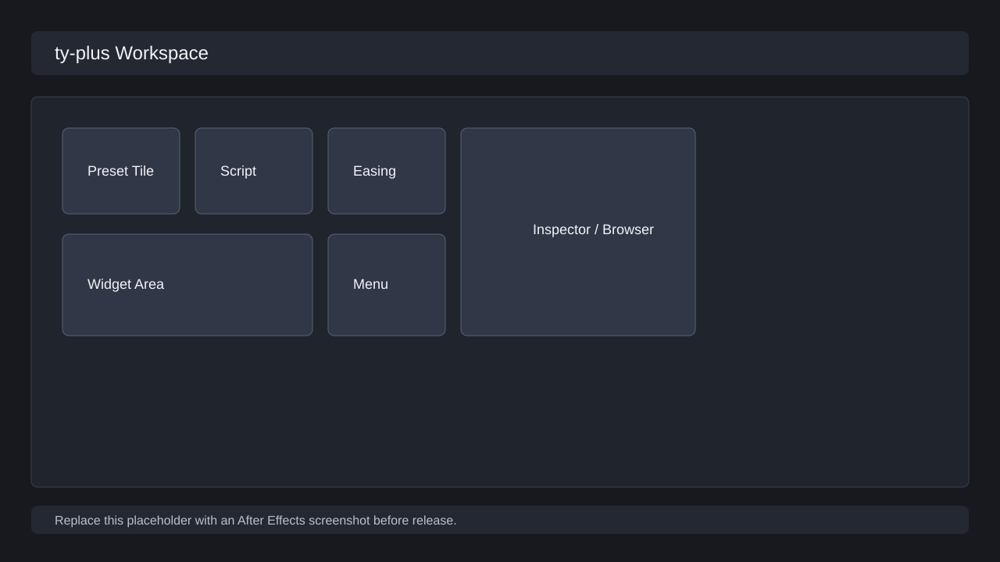
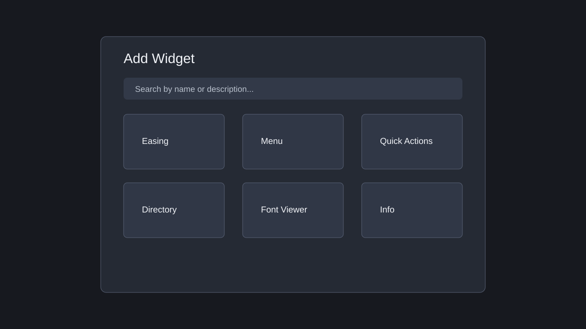

# ワークスペース

ワークスペースは、プリセットタイルとウィジェットを自由に配置して、After Effects の作業導線を短くする画面です。

## タイルを使う

| 操作 | 手順 | 結果 |
| --- | --- | --- |
| プリセットを実行 | プリセットタイルをクリック | 対応する `.ffx`、スクリプト、フッテージ操作などが AE に送られる |
| 選択する | タイルをクリック、または範囲選択 | コンテキストメニューや一括操作の対象になる |
| 移動する | タイルをドラッグ | グリッド上の位置が変わる |
| メニューを開く | 右クリック、またはメニューウィジェット | 編集、削除、移動、グループ化などを選べる |
| レイアウトを戻す | Undo / Redo | 直前の配置変更を戻す、またはやり直す |

## ウィジェットを追加する

1. メニューウィジェット、ステータスバー、またはウィジェット追加ダイアログを開きます。
2. 名前や説明でウィジェットを検索します。
3. 追加するウィジェットを選択します。
4. ワークスペースにタイルとして追加されたことを確認します。

## 主なウィジェット

| ウィジェット | 用途 |
| --- | --- |
| メニュー | プリセット作成、ウィジェット追加、保存、再読み込み、背景、Undo / Redo |
| イージング | カーブ編集、選択からコピー、反転、AE のキーフレームへ適用 |
| 整列 | 選択レイヤーや配置対象を整列する補助 |
| アンカーポイント | レイアウト参照やスナップ用の基準点 |
| レイアウト固定 | 誤操作によるタイル移動を防ぐ |
| クイックアクション | プリセット、スクリプト、プラグイン、エフェクト、ディスク上ファイルの検索実行 |
| ディレクトリブラウザ | サポートルート、プリセット、スクリプト、プラグインフォルダの参照 |
| フォントビューア | AE、Chromium、document.fonts から取得できるフォントを確認 |
| 情報 | 選択プリセットやコンポジションの情報を表示 |
| メモ / タイマー / YouTube | 作業補助用の常駐ツール |

## 背景を変更する

1. メニューから `背景...` を開きます。
2. 対象のワークスペースパネルを選びます。
3. 背景色、画像、表示方法を調整します。
4. 保存後、対象パネルの背景が更新されることを確認します。

## 複数パネル

ty-plus はプライマリパネルとセカンダリパネルの両方を扱います。セカンダリパネルでは、メイン操作を邪魔しない補助ウィジェットや別レイアウトを置けます。

確認すること:

- プライマリパネルで作成した設定変更が、必要な範囲でセカンダリパネルへ反映される。
- セカンダリパネルから開いたダイアログが、呼び出し元パネルへ結果を返す。
- パネル間でタイルを移動しても、保存と復元が破綻しない。

## レイアウトを保守する

- レイアウト固定を有効にすると、整理済みの配置を誤って動かしにくくなります。
- `左上へまとめる` は散らばったタイルを詰めます。
- レイアウト保存後は、AE 再起動、パネル再読み込み、サポートルート再読込で同じ配置になるか確認します。
